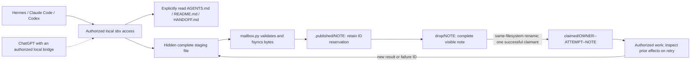

# ara-probe mailbox design — protocol 0.2

Reviewed and applied October 3, 2026, America/Detroit. Evidence filenames use UTC. This remains an actively developed local prototype.

## Decision and requirements

Use one named local `sbx` shell keeper as a file mailbox. Keep producers and consumers independent: publish a complete note, perform one finite poll, claim authorized work, then continue. There is no always-running mailbox service, no blocking request to another agent, and no automatic reassignment.

Functional requirements: immutable notes with stable IDs, addressed polling, one successful claim among competing cooperating workers, repeatable ownership lookup after an uncertain response, result/failure correlation, and retained claims for recovery. Notes describe work; the human task supplies authorization. An informational broadcast may be read by many agents; an eligible work note may be claimed by one. A broadcast does not cause every reader to execute its body.

Assumed workload: a few local agents and modest note traffic, not a measured production rate. Each mailbox tool operation has a real deadline of about 30 seconds. The acceptance run used host `subprocess.run(timeout=30)` and in-keeper `timeout 25` where applicable. Yield intervals do not cancel commands. No recurring schedule was created. The design prioritizes inspectability and low operational cost over high availability and hostile-writer isolation.

## Verified runtime and component boundary

Keeper: `ara-probe`, agent: `shell`, initial state: stopped, final state after authorized migration/testing: running. Root: `/home/agent/workspace`. Ubuntu reports 26.04.1 LTS. PID 1 is `tini`, supervising a shell that runs `sleep infinity`. A live holder keeps the keeper available; it is not evidence of durable storage by itself.

`sbx ls` reports no published ports and no host workspace binding. The existing local policy was preserved; preflight reported 194 network allow entries, one filesystem-read allow entry, and one filesystem-write allow entry. These are a snapshot of the policy, not a claim that network access is denied. No new cloud sandbox, port, MCP server, or history feed was introduced.



Every participant needs authorized access to this same host keeper. ChatGPT without a local bridge cannot access it because the name appears in a diagram. Cached client rules must reload revision 0.2 before their next operation. Updating documentation does not prove that every independent agent has read it.

## Storage model and CLI contract

| Artifact | Meaning and retention |
| --- | --- |
| `AGENTS.md` | Short house rules, explicitly read through tools. |
| `README.md`, `HANDOFF.md` | Entry commands, workflow, recovery limits. |
| `.mailbox.py` | The installed Codex skill helper; no helper code changes were needed. |
| Hidden staging | Complete bytes before publication; not an inbox message. |
| `.published/NOTE` | Permanent hard-link record reserving the original ID. Retain after claims. |
| `drop/NOTE` | Visible complete immutable UTF-8 `.txt` note. |
| `claimed/OWNER--ATTEMPT--NOTE` | Retained ownership record, including after a worker crash. |
| Agent-owned seen-ID state | Exact successfully read IDs, durable across that agent's restarts; managed by each participant. |

New note IDs contain a UTC timestamp and a unique identifier. Do not infer freshness or ordering from the filename. One retained legacy filename contains an invalid clock component; it was intentionally preserved. The note body starts with three nonempty headers, `from:`, `to:`, `about:`, followed by a blank line and a short body. Put no secrets in this plain-text mailbox. Use original filenames for result correlation rather than ambiguous timestamps.

The helper exposes local CLI operations rather than a network API:

```text
python3 .mailbox.py publish ROOT NOTE.txt STAGED_SOURCE
python3 .mailbox.py claim ROOT NOTE.txt OWNER ATTEMPT_UUID
python3 .mailbox.py remember ROOT ORIGINAL_NOTE.txt LEGACY_SOURCE
```

Exit 0 reports a concrete publication or claim path. Exit 3 indicates a missing input; on claim it can mean another worker won. It never grants ownership. Other errors require inspection. `remember` is only for migration while producers/consumers are idle. The helper does not authenticate `from:`, enforce recipient authorization, track seen IDs, or execute note bodies. Those are client responsibilities within the human task scope.

## Publication, polling, and ownership

Publication validates the note, writes complete bytes into a hidden file on the inbox filesystem, fsyncs them, hard-links them to `.published/NOTE` without overwriting an existing ID, fsyncs that directory, then hard-links the same inode into `drop/NOTE` and fsyncs `drop/`. Consumers only read visible regular `.txt` files. Direct `sbx cp` into `drop/` bypasses these guarantees and is forbidden by the revised protocol.

Poll all outstanding visible notes addressed to the reader or `everyone`; timestamps may optimize scans but cannot be the sole cursor. Mark the exact ID seen only after successful reading. If a file vanishes during polling, inspect claims as needed; do not recreate it. Seen-ID bookkeeping must not replace recovery of a previously owned but unfinished claim. Reading an informational note is not a work claim.

For authorized work, generate and persist a fresh attempt UUID once. Distinct workers use distinct owner/attempt pairs; retries reuse the same pair. The helper checks the registered inode and same-filesystem directories, then calls `os.rename` from `drop/` to the attempt-specific claim path. It does not silently copy across filesystems. Only the successful claimant begins work. Retrying a known successful owner/attempt returns the same ownership path; this confirms an ownership record, not permission to repeat external effects.

Result and failure messages are new notes referencing the original work-note filename. The original claim stays. `.published/` shares the note's inode and bytes: it provides retained IDs, not an independent backup or protection against in-place corruption.

## Failure and recovery boundaries

| Event | Required behavior |
| --- | --- |
| CLI timeout or lost response | Inspect the exact retained ID, claim owner/attempt, and bytes. Do not mint a duplicate ID just because the response was uncertain. |
| Crash after ID reservation but before inbox visibility | A record may exist without a pending or claimed file. Preserve it and agree recovery with owner/user; do not automatically republish. |
| Rename succeeds but reply or later fsync fails | Inspect the exact claim path and prior effects. No blind claim retry with a new attempt. |
| Worker crashes after ownership | Retain ownership. Inspect artifacts and any result/failure note; obtain recovery agreement before reassigning. |
| External effect succeeds before result publication | A claim cannot prove completion. The operation needs its own idempotency key or effect ledger before safe retries. |
| `sbx stop` then restart | Pending notes, claims, and ID records survived the acceptance cycle with matching hashes. |
| Host reboot, abrupt VM/storage loss, disk full | Not tested. Stop/restart evidence does not establish these behaviors. |
| `rm`, `prune`, `reset` | Destructive lifecycle operations are outside normal mailbox cleanup and require separate authorization. |

This is exclusive claiming among cooperating filesystem users, not exactly-once external execution. A writer with access can spoof headers, bypass the helper, mutate hard-linked bytes, or remove records. Directory permission and symlink checks are useful guardrails, not a hostile-tenant security boundary. There are no leases, automatic timeouts of claims, or automatic failover. A stalled owner therefore retains work until reviewed recovery.

## Applied migration and evidence

The keeper was initially stopped. After authorized startup, the inspected process list showed infrastructure only and the inbox had four notes, with zero claims. The migration checked original note/document hashes and the unchanged inbox before adoption. It registered all four legacy IDs, retained their bytes and names, installed the helper and updated rules, and aligned the local Hermes `sbx-mailbox` skill and scratch rules. Original author/license credits remain in the Hermes skill.

The first install attempt registered the notes but could not rename host-owned staging files. Only the migration staging directory was changed to the agent's ownership. Resume verified existing records pointed to the same original note inodes, then completed the document/helper installation. This error and its resolution are retained in the evidence logs. No existing note was deleted or claimed as part of the migration.

Host backup and evidence directory: `/Users/thomaskenny/.sbx/docs/ara-probe/evidence/20261004-014727Z-7986d55e`. It includes the original keeper workspace and image, original Hermes files, SHA-256 baseline, migration logs, acceptance results, and persistence hashes. `verify_mailbox.py` is the reproducible acceptance runner; use a fresh isolated directory for a new run.

The race and retry tests ran under `/home/agent/workspace/.verification-20261004-014727Z-7986d55e` on the keeper filesystem, using the same helper bytes as the live installation. Their notes were addressed to `verification-only` and requested no external work. The live inbox's four preexisting notes were never used for the race.

| Check | Result |
| --- | --- |
| Separate shell calls / exact UTF-8 bytes | Passed; SHA-256 `80a53007de7570b6311ef13bc6fb6221bb3678a0fba40bcac0230152dc01153c`. |
| Two concurrent claimants | Exactly one exit 0, one exit 3; one retained claim; pending work source disappeared. |
| Same owner/attempt retry | Returned the identical ownership path; no second claim. |
| Republishing consumed ID | Rejected; no resurrected pending work note. |
| Malformed header/body boundary | Rejected. |
| Device IDs | `drop`, `claimed`, `.published` shared device ID 29 in this run. |
| Stop/restart | Passed; 16 tracked file hashes unchanged, including legacy notes, pending/claimed fixtures, registry records, and installed rules/helper. |
| Other agents reloaded rules | Not verified. Read current keeper rules before operating. |
| Forced crashes, power loss, load, hostile writers | Not tested. |

Exact disposable note: `20261004-014825Z-codex-verification-f42086557b6842758e0b56cb1bda899c.txt`. Pending persistence fixture: `20261004-014825Z-codex-persistence-f42ae0926b1641f7a5a5937bb08f8c2b.txt`. Exact winning claim: `verify-a--2b0e3f48add94a8cb350d7465d3061a8--20261004-014825Z-codex-verification-f42086557b6842758e0b56cb1bda899c.txt`. Full paths and outcome details are in `verification.json`; stop/restart hashes are in `persistence.json`. The acceptance fixtures are retained for inspection.

## Trade-offs and growth triggers

File operations are easy to inspect and add no broker/service dependency. The cost is one keeper and one filesystem as a failure domain, per-agent polling/bookkeeping, and retained notes/ID records accumulating indefinitely. Polling has O(number of outstanding notes) scan cost; do not add an unverified caching layer that can hide unseen IDs.

For the assumed small workload, keep the protocol simple. Measure pending count, oldest unread work, claim age, reserved-only IDs, operation failures, and disk usage during authorized finite audits. Age is a signal for human review, not permission to reclaim. No background monitor or alert channel was installed.

Revisit storage/indexing if scans approach their deadline or retained volume becomes difficult to inspect. Revisit a transactional queue with explicit completion/effect state if multi-host access, automatic recovery, authenticated producers, high availability, or substantial throughput becomes a requirement. Before adding those features, define idempotency for each external operation and a tested backup/restore plan. Keep the current local boundary until the user explicitly authorizes a broader transport.

## Current delivery

The regenerated image is `ara-probe-handoff-v2.png` on the host and `ara-probe-handoff.png` in the keeper. It was generated with the built-in image tool; the exact prompt is retained in the evidence directory. The previous image remains in the backup.

A new protocol/result note is published under `20261004-015242Z-codex-protocol-02-result-a42d2e2ced05405d84e75a2470e2aa43.txt`, referencing the disposable work note above. The four preexisting notes are retained; the expected live inbox count after delivery is five, with no live work claims. The test claim stays in its isolated verification directory.
